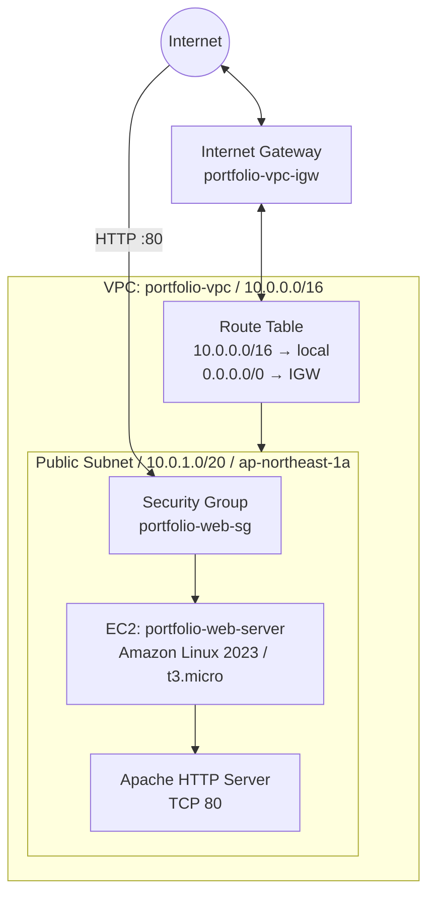

# Infrastructure Portfolio

インフラエンジニアとして学習した内容と、AWS上で実際に設計・構築・検証した内容をまとめたポートフォリオです。

## Overview

- **Webサイト**: HTML / CSS
- **ソースコード**: GitHub
- **AWS公開環境**: Amazon EC2 + Apache
- **AWSリージョン**: 東京（`ap-northeast-1`）
- **公開URL**: http://18.181.118.130

> この公開URLはEC2に割り当てられたパブリックIPv4アドレスです。インスタンスの停止・起動や再作成などで変更される場合があります。HTTPSはまだ設定していません。

## Project 01: AWS Web Server

<details>
<summary>構築内容</summary>

| 項目 | 設定 |
|---|---|
| VPC | `portfolio-vpc` |
| VPC IPv4 CIDR | `10.0.0.0/16` |
| Availability Zone | `ap-northeast-1a` |
| Public Subnet | `portfolio-vpc-subnet-public1-ap-northeast-1a` |
| Subnet IPv4 CIDR | `10.0.1.0/20` |
| Internet Gateway | `portfolio-vpc-igw`（VPCにアタッチ） |
| Route Table | `10.0.0.0/16 → local`、`0.0.0.0/0 → Internet Gateway` |
| Private Subnet | 未作成 |
| NAT Gateway | 未作成 |
| VPC Endpoint | 未作成 |
| Security Group | `portfolio-web-sg` |
| EC2 | `portfolio-web-server` |
| AMI | Amazon Linux 2023 |
| Instance Type | `t3.micro` |
| Storage | gp3、8 GiB |
| Web Server | Apache HTTP Server 2.4 |
| Web Root | `/var/www/html` |

</details>

### Architecture



### Security Group rules

Security Group: `portfolio-web-sg`

| Direction | Protocol | Port | Source / Destination | Purpose |
|---|---|---:|---|---|
| Inbound | TCP | 80 | `0.0.0.0/0` | Web access over HTTP |
| Inbound | TCP | 22 | `219.104.131.202/32` | SSH access from the configured client IP |
| Inbound | TCP | 22 | `com.amazonaws.ap-northeast-1.ec2-instance-connect` | Browser-based EC2 Instance Connect |
| Outbound | All | All | `0.0.0.0/0` | Default outbound rule |

SSH is not opened to `0.0.0.0/0`. The EC2 Instance Connect managed prefix list is used for browser-based SSH access. See [AWS documentation](https://docs.aws.amazon.com/ja_jp/AWSEC2/latest/UserGuide/ec2-instance-connect-prerequisites.html).

### Build and deployment steps

The following steps were performed in the AWS Management Console and the EC2 Instance Connect terminal.

1. Created the VPC and one public subnet.
2. Created and attached an Internet Gateway.
3. Configured the route table so that `0.0.0.0/0` routes to the Internet Gateway.
4. Created the Security Group with HTTP and restricted SSH inbound rules.
5. Launched an Amazon Linux 2023 EC2 instance (`t3.micro`, gp3 8 GiB) in the public subnet.
6. Connected to the instance using EC2 Instance Connect.
7. Updated packages and installed Apache and Git.

   ```bash
   sudo dnf update -y
   sudo dnf install httpd -y
   sudo dnf install git -y
   ```

8. Started Apache and enabled it at boot.

   ```bash
   sudo systemctl start httpd
   sudo systemctl enable httpd
   sudo systemctl status httpd
   ```

9. Cloned this public repository and copied the website files into Apache's document root.

   ```bash
   cd /home/ec2-user
   git clone https://github.com/takamihatsuki-crypto/infra-portfolio.git
   sudo cp -r /home/ec2-user/infra-portfolio/* /var/www/html/
   ```

10. Verified the local HTTP response with `curl -I http://localhost` and confirmed `HTTP/1.1 200 OK`.
11. Opened the EC2 public IPv4 address in a browser and confirmed that the portfolio page was displayed.

### Update deployment

After pushing website changes to the GitHub `main` branch, update the EC2 working copy and publish the files again:

```bash
cd /home/ec2-user/infra-portfolio
git pull origin main
sudo cp -r /home/ec2-user/infra-portfolio/* /var/www/html/
```

## Verification and remaining work

### Verified

- [x] VPC, public subnet, Internet Gateway and route table created
- [x] Security Group configured
- [x] EC2 instance launched and reachable with EC2 Instance Connect
- [x] Apache service running
- [x] Local HTTP response returns `200 OK`
- [x] Website files deployed from GitHub
- [x] Website accessible from a browser over HTTP

### Not implemented yet

- [ ] HTTPS / TLS certificate
- [ ] Domain name
- [ ] Private subnet and NAT architecture
- [ ] High availability across multiple Availability Zones
- [ ] Monitoring and alerting
- [ ] Architecture and deployment screenshots

## Skills

- AWS: VPC, Subnet, Internet Gateway, Route Table, Security Group, EC2
- Linux: Amazon Linux 2023, package management, systemd, file permissions
- Web: Apache HTTP Server, HTML, CSS
- Version Control: Git / GitHub

## Purpose

クラウドインフラの設計・構築・運用に必要な知識を、実際に手を動かして習得することを目的としています。
