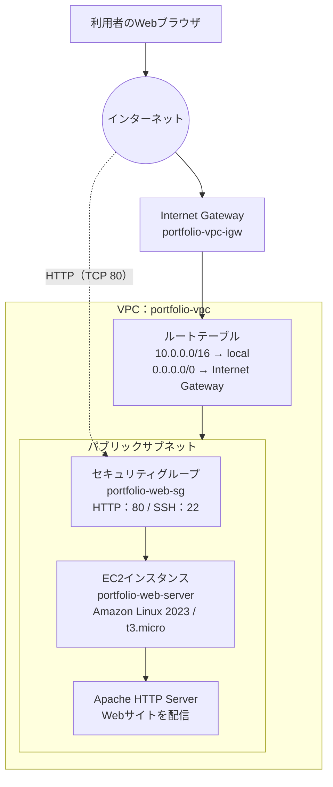

# インフラエンジニア ポートフォリオ

AWSを利用したインフラ環境の設計・構築と、Webサイトの公開を実践した記録です。
構築した内容だけでなく、ネットワーク構成、セキュリティ設定、作業手順、動作確認の結果をまとめています。

## 1. プロジェクト概要

### AWSを利用したWebサーバーの構築

AWS上に仮想ネットワークとEC2インスタンスを作成し、Apacheを使ってポートフォリオサイトを公開しました。

| 項目 | 内容 |
|---|---|
| 目的 | AWS上にWebサーバーを構築し、Webサイトをインターネットに公開する |
| クラウドサービス | Amazon Web Services（AWS） |
| リージョン | 東京リージョン（`ap-northeast-1`） |
| サーバーOS | Amazon Linux 2023 |
| インスタンス | Amazon EC2（`t3.micro`） |
| Webサーバー | Apache HTTP Server 2.4 |
| Webサイト | HTML / CSS |
| ソースコード管理 | Git / GitHub |
| 公開URL | http://18.181.118.130 |

> **公開環境について：** 現在はHTTPで公開しています。HTTPS（TLS証明書）と独自ドメインは未設定です。また、上記IPアドレスはEC2のパブリックIPv4アドレスのため、インスタンスの停止・起動や再作成などにより変更される場合があります。

## 2. システム構成

### 構成図

次の構成で、インターネットからEC2上のApacheにHTTP（TCP 80）でアクセスできるようにしています。



### ネットワーク設計

| 項目 | 設定値 | 役割 |
|---|---|---|
| VPC | `portfolio-vpc` | AWS上に作成した仮想ネットワーク |
| VPCのIPv4 CIDR | `10.0.0.0/16` | VPC内で使用するIPアドレス範囲 |
| アベイラビリティゾーン | `ap-northeast-1a` | EC2を配置したAZ |
| パブリックサブネット | `portfolio-vpc-subnet-public1-ap-northeast-1a` | インターネット接続を行うEC2を配置 |
| サブネットのIPv4 CIDR | `10.0.1.0/20` | サブネット内で使用するIPアドレス範囲 |
| Internet Gateway | `portfolio-vpc-igw` | VPCとインターネット間の通信経路 |
| ルートテーブル | メインのルートに加え、インターネット向けルートを設定 | 通信の宛先に応じた経路制御 |

### ルートテーブル

| 宛先 | ターゲット | 意味 |
|---|---|---|
| `10.0.0.0/16` | `local` | VPC内部の通信 |
| `0.0.0.0/0` | Internet Gateway | VPC外部（インターネット）向けの通信 |

パブリックサブネットに配置したEC2がインターネットと通信できるよう、デフォルトルート（`0.0.0.0/0`）のターゲットにInternet Gatewayを指定しています。

### セキュリティグループ

セキュリティグループ名：`portfolio-web-sg`

| 方向 | プロトコル | ポート | 接続元・接続先 | 用途 |
|---|---|---:|---|---|
| インバウンド | TCP | 80 | `0.0.0.0/0` | WebサイトへのHTTPアクセス |
| インバウンド | TCP | 22 | 接続元のグローバルIP（/32） | SSH接続 |
| インバウンド | TCP | 22 | EC2 Instance Connectの管理プレフィックスリスト | ブラウザからのEC2 Instance Connect接続 |
| アウトバウンド | すべて | すべて | `0.0.0.0/0` | デフォルトの送信ルール |

**セキュリティ上の考慮点**

- Webサイトを一般公開するため、HTTP（TCP 80）は全IPv4アドレスからのアクセスを許可しています。
- SSH（TCP 22）は全世界に公開せず、接続元IPを限定しています。
- EC2 Instance Connectからの接続には、AWS管理のプレフィックスリストを使用しています。
- SSHの接続元IPは環境に応じて変わるため、このREADMEでは具体的なIPアドレスを公開していません。

参考：[EC2 Instance Connectの前提条件（AWS公式ドキュメント）](https://docs.aws.amazon.com/ja_jp/AWSEC2/latest/UserGuide/ec2-instance-connect-prerequisites.html)

## 3. EC2・Webサーバーの構築

### EC2インスタンス

| 項目 | 設定 |
|---|---|
| インスタンス名 | `portfolio-web-server` |
| OSイメージ | Amazon Linux 2023 |
| インスタンスタイプ | `t3.micro` |
| vCPU | 2 |
| メモリ | 1 GiB |
| ストレージ | gp3 / 8 GiB |
| 配置先 | `portfolio-vpc` のパブリックサブネット |

### 構築手順

以下は、AWSマネジメントコンソールとEC2 Instance Connectを使用して実施した手順です。

1. **VPCとサブネットの作成**
   - VPC（`10.0.0.0/16`）を作成
   - パブリックサブネット（`10.0.1.0/20`）を作成
   - サブネットのパブリックIPv4アドレス自動割り当てを有効化

2. **インターネット接続の設定**
   - Internet Gatewayを作成してVPCにアタッチ
   - ルートテーブルに `0.0.0.0/0 → Internet Gateway` を追加
   - パブリックサブネットをルートテーブルに関連付け

3. **セキュリティグループの作成**
   - HTTP（TCP 80）の受信を許可
   - SSH（TCP 22）は接続元IPとEC2 Instance Connect用のプレフィックスリストに限定

4. **EC2インスタンスの作成**
   - Amazon Linux 2023、`t3.micro` を選択
   - 作成したVPCとパブリックサブネットに配置
   - 作成したセキュリティグループを適用

5. **EC2 Instance Connectで接続**
   - AWSマネジメントコンソールからブラウザ接続
   - ログインユーザー：`ec2-user`

6. **パッケージの更新とApache・Gitのインストール**

   ```bash
   sudo dnf update -y
   sudo dnf install httpd -y
   sudo dnf install git -y
   ```

7. **Apacheの起動と自動起動設定**

   ```bash
   sudo systemctl start httpd
   sudo systemctl enable httpd
   sudo systemctl status httpd
   ```

   `Active: active (running)` と表示されることを確認しました。

8. **GitHubからWebサイトのソースコードを取得**

   ```bash
   cd /home/ec2-user
   git clone https://github.com/takamihatsuki-crypto/infra-portfolio.git
   ```

9. **Apacheの公開ディレクトリへ配置**

   ```bash
   sudo cp -r /home/ec2-user/infra-portfolio/* /var/www/html/
   ```

   HTMLファイルとCSSフォルダが配置されたことを確認しました。

## 4. 動作確認

構築後、次の項目を確認しました。

| 確認項目 | 確認方法 | 結果 |
|---|---|---|
| Apacheの起動状態 | `systemctl status httpd` | `active (running)` を確認 |
| Webサーバーの応答 | `curl -I http://localhost` | `HTTP/1.1 200 OK` を確認 |
| Webサイトの配置 | `/var/www/html` の内容を確認 | `index.html` と `css` フォルダを確認 |
| 外部からのアクセス | ブラウザで公開IPにアクセス | Webサイトの表示を確認 |

### 公開サイト

[Infrastructure Portfolio（AWS EC2）](http://18.181.118.130)

## 5. Webサイトの更新手順

GitHubの`main`ブランチに変更を反映した後、EC2上で次のコマンドを実行すると、公開ファイルを更新できます。

```bash
cd /home/ec2-user/infra-portfolio
git pull origin main
sudo cp -r /home/ec2-user/infra-portfolio/* /var/www/html/
```

## 6. 現時点の対応状況と今後の改善

### 実施済み

- [x] VPC・パブリックサブネットの作成
- [x] Internet Gatewayの作成とVPCへのアタッチ
- [x] ルートテーブルの設定
- [x] セキュリティグループの設定
- [x] EC2インスタンスの作成
- [x] EC2 Instance Connectによる接続
- [x] Apacheのインストール・起動
- [x] GitHubからのソースコード取得
- [x] EC2へのWebサイト配置
- [x] HTTPによる外部公開とブラウザでの表示確認

### 今後の改善予定

- [ ] HTTPS化（TLS証明書の導入）
- [ ] 独自ドメインの設定
- [ ] CloudWatchによるメトリクス監視・アラーム設定
- [ ] プライベートサブネットを含む構成の検討
- [ ] 複数AZを利用した可用性向上の検討
- [ ] AWS構成図や動作確認画面のスクリーンショット追加

※上記は今後の改善項目です。現時点で未構築の機能を、実装済みとして記載していません。

## 7. 使用技術・学習項目

- **AWS：** VPC、Subnet、Internet Gateway、Route Table、Security Group、EC2
- **Linux：** Amazon Linux 2023、dnf、systemd、Linuxコマンド
- **Webサーバー：** Apache HTTP Server
- **Web制作：** HTML、CSS
- **バージョン管理：** Git、GitHub

## 8. 制作目的

クラウドインフラの基本的な仕組みを理解し、ネットワークの設計からサーバー構築、Webサイトの公開、動作確認までを一通り実践することを目的としています。

今後も実際に構築・検証した内容を追加し、インフラエンジニアとしての技術習得の記録を更新していきます。
